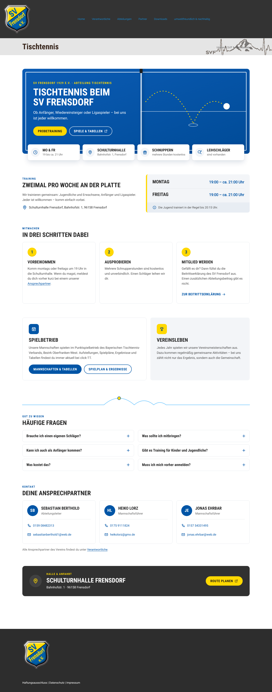
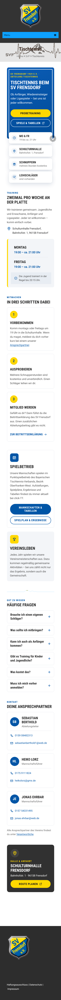

# SV Frensdorf – Tischtennis-Seite

Neue Inhalte für die Tischtennis-Seite des SV Frensdorf 1929 e.V.
Sie ersetzen den bisherigen Hinweis auf <https://svfrensdorf.de/dt_activities/tischtennis/>.

- Nur Text und Grafik: keine Fotos, kein JavaScript, kein Tracking, keine Cookies.
- Lädt nichts von fremden Servern. Google Maps ist nur ein normaler Link.
- Muss nicht gepflegt werden: Mannschaften, Spielpläne und Tabellen kommen über
  saisonunabhängige Links auf click-TT immer aktuell.

| WordPress (Desktop) | WordPress (Handy) |
|---|---|
|  |  |

Die Bilder zeigen den Block testweise in der echten Live-Seite mit dem Theme von svfrensdorf.de.
Die eigenständige Variante zeigt [docs/vorschau-eigenstaendig-desktop.png](docs/vorschau-eigenstaendig-desktop.png).

---

## Einbau (für den Hoster / Webmaster)

Es gibt zwei fertige Dateien im Ordner `dist/`. Man braucht nur **eine** davon.

### Variante A – in WordPress (empfohlen)

Datei: **`dist/wordpress-block.html`** (eine einzige Zeile, ca. 28 KB)

1. Mit einem **Administrator**-Konto anmelden.
   Nur Administratoren und Redakteure dürfen in WordPress `<style>` und SVG speichern.
   Bei anderen Rollen entfernt WordPress diese Teile beim Speichern.
2. Die Aktivität **„Tischtennis“** öffnen (Adresse `/dt_activities/tischtennis/`).
3. Den bisherigen Inhalt (blaue Hinweisbox „Bitte informieren Sie sich beim Vorstand …“) löschen.
4. Den **kompletten** Inhalt von `dist/wordpress-block.html` einfügen.
   Auf GitHub geht das über „Raw“ und dann alles markieren und kopieren.
   - **WPBakery:** Element **„Raw HTML“** hinzufügen und dort einfügen.
   - **Block-Editor (Gutenberg):** Block **„Individuelles HTML“**.
   - **Klassischer Editor:** Reiter **„Text“**, nicht „Visuell“. Danach nicht mehr auf „Visuell“ umschalten.
5. Speichern bzw. Aktualisieren und die Seite ansehen.

Optional: Kommentare für diese Seite abschalten, falls die Antworten dort niemand liest.

### Variante B – als eigene Datei auf dem Server

Datei: **`dist/tischtennis.html`**

Diese Datei ist eine vollständige Seite mit schlankem Kopf und Fuß im Stil der Hauptseite.
Sie verlinkt zurück auf svfrensdorf.de und nutzt deren Impressum und Datenschutz.
Weitere Dateien braucht sie nicht, auch die Schrift ist eingebettet.

Beispiel: hochladen als `/tischtennis/index.html` → `https://svfrensdorf.de/tischtennis/`.
Danach die bisherige WordPress-Tischtennisseite auf diese Adresse verlinken oder weiterleiten.

---

## Inhalte und Quellen (Stand 02.11.2026)

| Inhalt | Quelle |
|---|---|
| Training Mo & Fr, 19:00 bis ca. 21:00 Uhr; Jugend i. d. R. bis 20:15 Uhr | Abteilung |
| Schnupperstunden kostenlos, Leihschläger vorhanden, kein Abteilungsbeitrag | Abteilung |
| Jährliche Vereinsmeisterschaften, regelmäßige Aktivitäten | Abteilung |
| Schulturnhalle Frensdorf, Bahnhofstr. 1, 96158 Frensdorf | click-TT / myTischtennis (Spiellokal) |
| Sebastian Berthold (Abteilungsleiter), Mail + Telefon | click-TT / myTischtennis |
| Heiko Lorz (Mannschaftsführer), Mail | myTischtennis; Telefon von der Abteilung |
| Jonas Ehrbar (Mannschaftsführer), Mail + Telefon | click-TT / myTischtennis |
| Links zu Mannschaften, Spielplan, Ergebnissen | click-TT, interne Vereinskennung 23708 (ohne Saison im Link) |

Bewusst nicht auf der Seite: Ligen, Tabellenplätze, Beträge und Privatadressen.
Das alles würde veralten oder gehört nicht auf eine öffentliche Seite.

## Wenn sich doch etwas ändert

Zum Beispiel ein neuer Ansprechpartner oder neue Trainingszeiten:

1. Text in `src/block.html` ändern. Das ist normales HTML und gut lesbar.
2. `node build.mjs` ausführen. Das erzeugt beide Dateien in `dist/` neu.
3. Die neue `dist/wordpress-block.html` wie oben einfügen.

## Für Entwickler

```
src/block.html        Inhalt (einzige Quelle)
src/block.css         Gestaltung, komplett unter #svf-tt gekapselt
src/page.html/.css    Rahmen der eigenständigen Seite
src/fonts/            Roboto Condensed Bold (SIL Open Font License, siehe OFL.txt)
build.mjs             baut dist/ (nur Node.js, keine Pakete nötig)
tests/verify.mjs      prüft alles (Playwright + curl, braucht Internet)
docs/                 Vorschaubilder
```

So ist der Block gebaut:

- **Gekapselt:** Alle Regeln stehen unter `#svf-tt` und setzen Schrift, Farben, Abstände und Listen selbst.
  So kann das Theme nichts verstellen, und der Block verändert nichts am Theme.
- **Richtet sich nach seiner eigenen Breite** (Container Queries), nicht nach dem Fenster.
  Das Theme ist auf dem Handy nur ca. 290 px breit.
- **Gegen WordPress-Formatierung geschützt:** Der WordPress-Block steht in einer Zeile.
  So kann auch der klassische Editor keine `<p>`- oder `<br>`-Tags einbauen.
- **Mail-Adressen** stehen als HTML-Entities im Code. Browser zeigen sie normal an,
  einfache Adress-Sammler finden sie nicht.

```bash
node build.mjs
node tests/verify.mjs          # alle Prüfungen
node tests/verify.mjs --docs   # zusätzlich Vorschaubilder nach docs/ kopieren
```

`tests/verify.mjs` prüft:

- **Statisch:** kein JavaScript, keine externen Quellen, keine Leerzeilen, Mail-Adressen nicht im Klartext
- **Fakten:**
  - Kontaktdaten und Halle gegen myTischtennis und click-TT, live abgerufen
  - Angaben der Abteilung gegen eine feste Liste
- **Links:** alle Links erreichbar; `tel:` und `mailto:` richtig formatiert; Sprungmarken vorhanden
- **Im echten Theme:** Der Block wird in die Live-Seite eingesetzt und bei 1400, 768 und 375 px geprüft:
  - kein seitliches Scrollen und kein Text ragt heraus
  - das Theme verstellt keine Schriften, Farben oder Listen
  - Tippflächen und Kontrast (WCAG AA) passen
  - die Fragen klappen auf und zu, und der Sprung zu „Probetraining“ landet nicht unter dem festen Kopf
- **Eigenständige Seite:** dieselben Prüfungen, außerdem null Anfragen an fremde Server
- **HTML-Validierung** mit `html-validate`

Die Quell-Links für den Faktenabgleich in `tests/verify.mjs` (`SOURCES`) gelten für die Saison 2026/27.
In einer neuen Saison müssen sie angepasst werden. Die Links **auf der Seite** selbst enthalten keine Saison.
